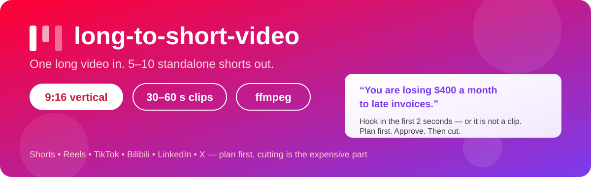
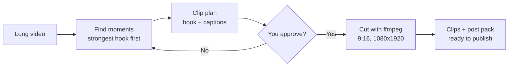

<p align="center">
  
</p>

<p align="center">
  <b>🚀 Try the live demo — <a href="https://smabdulmueid97.github.io/long-to-short-video/">See it in action</a></b>
</p>

<p align="center">
  <a href="https://smabdulmueid97.github.io/long-to-short-video/"></a>
  <a href="https://github.com/smabdulmueid97/long-to-short-video/blob/main/LICENSE"></a>
  <a href="https://github.com/smabdulmueid97/long-to-short-video"></a>
  <a href="https://github.com/smabdulmueid97/long-to-short-video"></a>
  <a href="https://github.com/smabdulmueid97/long-to-short-video/stargazers"></a>
</p>

<h1 align="center">long-to-short-video</h1>

<p align="center">
  One long video → <b>5–10 standalone shorts</b> for YouTube Shorts, Instagram Reels, Facebook Reels, TikTok, Bilibili, LinkedIn, and X.<br />
  Every clip must make sense with <b>no context</b> from the long video.
</p>

<p align="center">
  🔗 <b><a href="https://smabdulmueid97.github.io/long-to-short-video/">Live: https://smabdulmueid97.github.io/long-to-short-video/</a></b>
</p>

<p align="center">
  <a href="#-how-it-works">How it works</a> •
  <a href="#-the-rules-of-a-good-clip">Good clip</a> •
  <a href="#-platform-limits">Limits</a> •
  <a href="#-install-30-seconds">Install</a> •
  <a href="#%EF%B8%8F-cut-with-ffmpeg">Cut</a>
</p>

---

## Why this exists

One long tutorial, podcast, or stream holds a dozen good moments — but a clip that only makes sense if you watched the whole thing is not a short. This skill finds the moments that stand alone, writes the hook and captions, and shows you the plan to approve **before** cutting. Cutting is the expensive part.



## 🎬 The rules of a good clip

| # | Rule | What it means |
|---|---|---|
| 1 | **One idea per clip** | If it needs "as I said earlier", it's not a clip. |
| 2 | **Hook in the first 2 seconds** | A question, a bold claim, or a result — never "hi, welcome back". |
| 3 | **30–60 seconds is the sweet spot** | 90 seconds max for a universal clip. |
| 4 | **Captions burned in** | Most people watch muted. Big, high-contrast, centred, inside the safe zone. |
| 5 | **Vertical first** | Master export: 9:16, 1080×1920, H.264 MP4 + AAC, 30 fps. |

## 📱 Platform limits

Ceilings checked Oct–Nov 2026:

| Platform | Limit |
|---|---|
| YouTube Shorts | ≤ 3 min |
| Instagram Reels | ≤ 3 min recommended to new audiences |
| TikTok | Up to 60 min upload — but clips should stay short |
| X (free) | ≤ 2 min 20 s, ≤ 512 MB |
| LinkedIn | ≤ 15 min, but 30–120 s performs best |
| Bilibili | Vertical 3–15 min sweet spot |

One master clip does not fit everywhere: LinkedIn gets a professional hook (cut the joke, keep the lesson), Bilibili gets a Chinese title + tags and a cover frame when the audience is Chinese.

## 🚀 Install (30 seconds)

```bash
git clone https://github.com/smabdulmueid97/long-to-short-video.git
./install.sh
# copies this skill to ~/.claude/skills/long-to-short-video/
```

Or manually: copy `SKILL.md` to `~/.claude/skills/long-to-short-video/SKILL.md`.

Requires only `ffmpeg` for cutting: `brew install ffmpeg` / `apt install ffmpeg`.

## 💬 Use it

```
turn this 40-minute tutorial into 5 shorts for Shorts, Reels and TikTok
```

The skill finds the best moments, writes hooks + captions, and shows you a clip plan to approve **before** cutting.

## ✂️ Cut with ffmpeg

```bash
./scripts/make-clips.sh input.mp4 clips.csv
# clips.csv: clip-name,start,end  (one per line, e.g. invoice-trick,00:12:04,00:12:58)
```

Outputs 9:16, 1080×1920 clips, loudness normalised to −14 LUFS. See [`templates/clip-plan.md`](templates/clip-plan.md) for the plan format.

## 🚫 What it won't do

- Generate video — it plans and cuts from a video **you** provide.
- Cut a clip that only makes sense inside the long video.
- Post the clips itself — it hands over the files + the post pack.
- Use copyrighted music from one platform's library on another platform.

## 🗂️ Layout

```
assets/banner.svg               # hero banner above
SKILL.md                        # the skill
templates/clip-plan.md          # clip plan format
scripts/make-clips.sh           # ffmpeg cutter, clips.csv in, 9:16 clips out
install.sh                      # copies the skill to ~/.claude/skills/
```

## License

MIT
